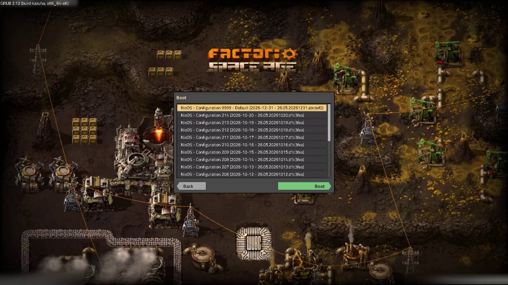

# grub-foundry-theme

GRUB theme of factory game, the load game screen. Goes with
[sddm-foundry-theme](https://github.com/PandeCode/sddm-foundry-theme).



## Use with Nix

```nix
{
  inputs.grub-foundry-theme.url = "github:PandeCode/grub-foundry-theme";
}
```

```nix
{
  boot.loader.grub.theme = inputs.grub-foundry-theme.packages.${pkgs.stdenv.hostPlatform.system}.default.override {
    background = ./boot.png;   # image or video, a video gives its first frame
    scale = 1.5;               # 1 for 1080p, 1.5 for 1600p, 2 for 4k
    corner = "kazuha";
  };
}
```

The list is as wide as the longest entry NixOS or os-prober writes, so
names are never cut off. Pass `longest = [ "..." ]` for anything longer.

## Use without Nix

Needs python3 with pillow, `grub-mkfont` and ffmpeg.

```bash
./build.sh --background boot.png --mono /usr/share/fonts/TTF/DejaVuSansMono.ttf /boot/grub/themes/foundry
```

Then `GRUB_THEME=/boot/grub/themes/foundry/theme.txt` in
`/etc/default/grub` and `grub-mkconfig -o /boot/grub/grub.cfg`.
`./gen.py --help` lists the other options.

## Fonts

Titillium Web, under the SIL Open Font License, see `fonts/OFL.txt`.
